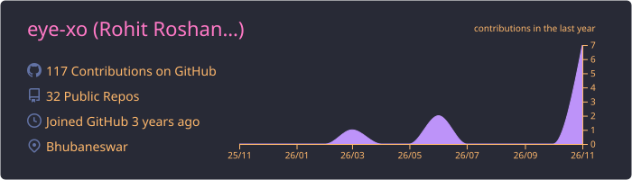
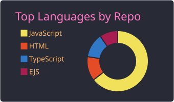
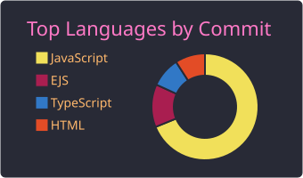
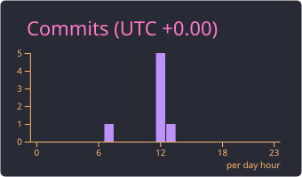

<!-- ═══════════════════════ HEADER ═══════════════════════ -->
<p align="center">
  
</p>

<p align="center">
  <a href="https://github.com/eye-xo">
    
  </a>
</p>

<p align="center">
  
  <a href="https://gitarena.dev/u/eye-xo"></a>
  <a href="https://github.com/eye-xo?tab=followers"></a>
</p>

<!-- ═══════════════════════ ABOUT ═══════════════════════ -->
## 💫 About Me


```js
const rohit = {
  role:        "Full Stack Developer 🚀",
  currently:   "Teaching Assistant @ Coding Ninjas 🎓",
  experience:  "~6 months of internships building real web apps",
  stack:       ["MongoDB", "Express.js", "React.js", "Node.js"],
  learning:    ["Next.js", "MySQL"],
  vibe:        "clean, efficient code ✨",
  askMeAbout:  ["React", "Node", "debugging your weird bugs 🐛"],
};
```

- 🔭 Crafting robust full-stack web apps with the **Full** stack
- 🎓 Helping aspiring developers level up at **Coding Ninjas**
- 🌱 Diving deep into **Next.js** & **MySQL** and modern app architecture
- 💬 Open to collaborating on exciting projects — or just chatting tech 😄

<br clear="right"/>

<!-- ═══════════════════════ CONNECT ═══════════════════════ -->
## 🌐 Let's Connect

<p align="left">
  <a href="https://www.linkedin.com/in/rohit-roshan-sahu-"></a>
  <a href="https://www.instagram.com/ig_eyexo"></a>
  <a href="https://rohit-portfolio-seven.vercel.app/"></a>
  <a href="https://gitarena.dev/u/eye-xo"></a>
</p>

<!-- ═══════════════════════ TECH STACK ═══════════════════════ -->
## 💻 Tech Arsenal

<p align="center">
  <br/>
  <br/>
  
</p>

<p align="center">
  
  
  
  
  
  
  
  
  
  
</p>

<!-- ═══════════════════════ GITARENA ═══════════════════════ -->
## ⚔️ GitArena

<p align="center">
  <a href="https://gitarena.dev/u/eye-xo"></a>
  <a href="https://gitarena.dev/u/eye-xo"></a>
</p>
<p align="center">
  <a href="https://gitarena.dev/u/eye-xo"></a>
</p>

<!-- ═══════════════════════ STATS ═══════════════════════ -->
## 📊 GitHub Stats

<p align="center">
  
  
</p>

<p align="center">
  
</p>

<p align="center">
  
</p>

<!-- ═══════════════════════ TROPHIES ═══════════════════════ -->
## 🏆 Trophy Cabinet

<p align="center">
  
</p>

<!-- ═══════════════════════ TOP REPOS ═══════════════════════ -->
## 🔝 Repo & Coding Insights

<p align="center">
  
</p>
<p align="center">
  
  
  
</p>

<!-- ═══════════════════════ SNAKE ═══════════════════════ -->
## 🐍 Watch the snake eat my contributions

<p align="center">
  
</p>

<!-- ═══════════════════════ QUOTE ═══════════════════════ -->
## ✍️ Random Dev Quote

<p align="center">
  
</p>

<!-- ═══════════════════════ FOOTER ═══════════════════════ -->
<p align="center">
  
</p>
